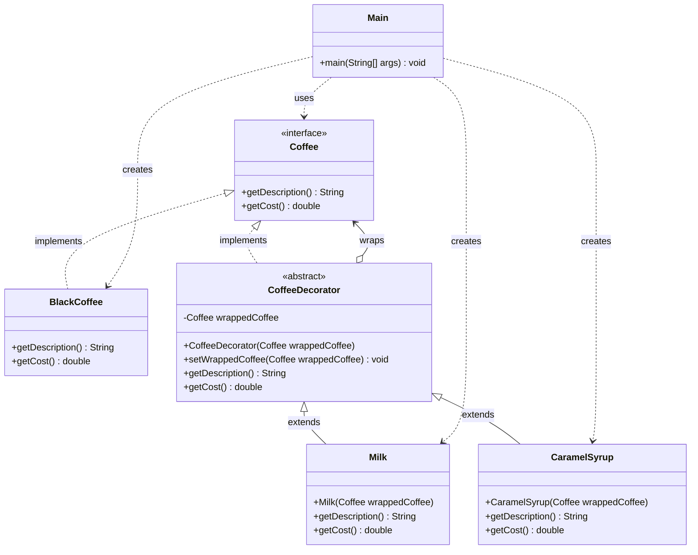

# Customizing Coffee Orders (Decorator Pattern)

## Problem Statement

A popular coffee shop, "Brewtiful," wants a flexible way to calculate the cost and list the ingredients of customized coffee orders. Customers can choose a basic coffee type, and then add various toppings or flavor shots. The system must allow for any combination of additions.

### Key Requirements

- **Core Component:** A basic coffee (e.g., Espresso, Black Coffee) with a base cost.
- **Dynamic Enhancements:** Additions like Milk, Sugar, Caramel Syrup, or Whipped Cream must be applied on top of the basic coffee.
- **Combinability:** Customers should be able to combine multiple additions (e.g., an Espresso with Milk and Caramel).
- **Interface Consistency:** All components (basic coffee and additions) should share a common interface so that additions can wrap other additions or the base coffee.

## Implementation Structure (Coffee Shop)

1. **Coffee (Component Interface):** Defines `getDescription()` and `getCost()`.
2. **BlackCoffee (Concrete Component):** Returns `"Black Coffee"` and a base cost of `₱ 100.00`.
3. **CoffeeDecorator (Decorator Abstraction):** Abstract class implementing `Coffee`, holding a `private Coffee wrappedCoffee` reference with a constructor and setter (`setWrappedCoffee`).
4. **Milk & CaramelSyrup (Concrete Decorators):** Extend `CoffeeDecorator`, adding `", Milk"` (`+ ₱ 25.00`) and `", Caramel Syrup"` (`+ ₱ 40.00`).
5. **Main (Client):** Demonstrates standalone and combined coffee orders.

## UML Class Diagram

